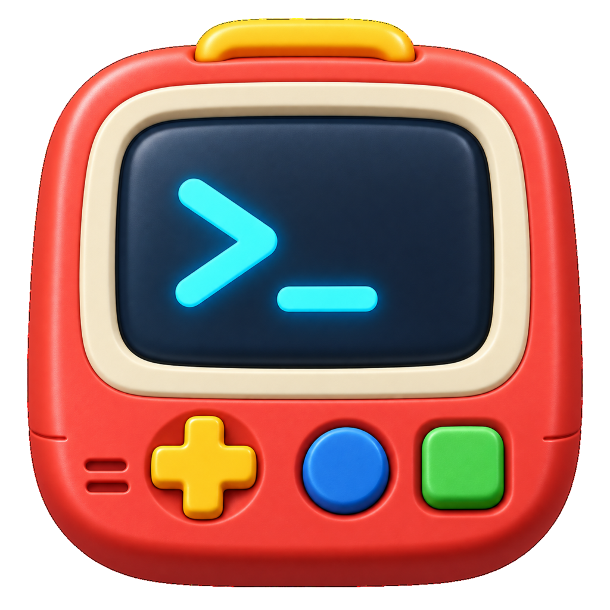

# toyoterm

<p align="center">
  
</p>

[English](README.md)

toyotermはRustと組み込みmrubyによる、プログラム可能な実験的ターミナルエミュレータです。
端末処理はネイティブで行い、Rubyを設定、キーバインド、イベント、コマンドに使用します。
自分で使うために作っている個人の実験的プロジェクトです。

> [!IMPORTANT]
> 開発中です。Workspace・Tab・分割Paneは独立したPTYと端末セッションを持ちます。OSウィンドウはGUIプロセスごとに1つです。`toyoterm`を再度実行すると、別プロセスと別ウィンドウが起動します。1プロセス内の複数OSウィンドウは初回リリース後の対応予定です。

## 機能

- ネイティブPTY、`alacritty_terminal`によるVT解析、`wgpu`と`glyphon`によるGPU描画
- Workspace、Tab、Pane分割・ズームと独立したシェルセッション
- 全角文字上ではブロック型・下線型カーソルを2セル幅で表示。ブロック型カーソルに重なる文字は、カーソル文字色の明示指定がなければ、読みやすい色を自動選択して表示
- UTF-8・IME入力、Kitty keyboard protocolの段階的拡張、マウストラッキングとSGRマウスレポーティング、長さ制限付きOSC 50実行時フォントファミリー切替、Kitty OSC 66のセルをまたぐ文字と分数倍率表示、入力時に最下部へ戻るスクロールバック、検索、選択、クリップボードへのコピー・貼り付け
- 独立したアイコンタイトル情報を含むOSCタイトル・iTerm2セッション色／ANSI色／リンク色／選択色／カーソル文字色／下線色／ビジュアルベル色／透明背景色／Display P3色／登録済みRubyテーマプリセットを含むパレット／動的色／文字属性特殊色の制御・色スタック、OSC 8リンク、タブ色・サイズ制限付きPaneバッジ・iTerm2の全進捗状態・セッション状態インジケーター、明示許可・サイズ制限付きクリップボードコピー・URL起動・フォーカス要求、標準サウンド・名前付きアイコン・転送アイコンのキャッシュと表示条件・優先度・全デスクトップの応答通知に対応したデスクトップ通知、カーソル花火を含む注意要求、URL自動検出、作業ディレクトリ・リモートホスト・連携バージョン・終了状態付きコマンドマーカーとキャプチャ出力消去・プロンプト移動・iTerm2マーク移動を行うシェル連携（[対応表](docs/osc-support.md)）
- Linux・macOS・Windowsでの7/8ビットSixel・Kitty画像プロトコル（TUIフレームワークが使うUnicode placeholderを含む）・iTerm2 OSC 1337による画像表示と、明示許可・サイズ制限付きiTerm2／Kittyファイルダウンロードおよび固定ルート内に限定したKittyアップロード。子セッションでは外側の端末から継承した古い機能判定用環境変数を除去し、TUI画像ライブラリがtoyotermを正しく判定できるようにします（[対応範囲と実行例](docs/image-protocols.md)）
- mruby 4.0による設定、ネイティブ・Rubyキーバインド、イベント、コマンド、ローカルRubyライブラリ、テーマ、検索可能な選択オーバーレイ
- アトミックな設定リロード、ライブRubyコンソール、ローカルIPC、ウィンドウバーと壁紙（明示許可・固定ルート内に限定したOSC壁紙変更を含む）
- OSCの許可設定を `config.osc` に集約。ダウンロード・アップロード・OSC壁紙変更は絶対パスのディレクトリを指定するだけで有効化できます（[設定API](docs/mruby-api.md#configosc)）

## 現在の状態

主な開発環境はLinuxです。CIではLinux・macOS・Windowsのビルド、テスト、パッケージ作成、
GUI起動スモークテストを実行します。各OSの実機でも主要な動作を一通り確認しています。
リリース候補版では[プラットフォーム検証](docs/platform-validation.md)の項目を改めて確認します。
CIとライセンス検査はPRと`master`へのpushで実行します。作業ブランチへのpushでは実行しません。
1つのGUIプロセス内での複数OSウィンドウとセッション永続化は初回リリースの対象外です。
Rubyの`MuxWindow`は、そのGUIプロセスの単一OSウィンドウ内で表示するMux上のウィンドウを表します。

## ビルドと起動

最近の安定版Rust、同梱mrubyをビルドするCコンパイラ、`winit`・`wgpu`に必要な
プラットフォームライブラリが必要です。LinuxではWaylandまたはX11セッションと、
xkbcommon・`pkg-config`などの開発用ライブラリを用意してください。Windowsの描画にはDirectX 12が必要です。

```sh
cargo run --locked
```

最適化ビルドは`cargo build --release --locked`で作成し、Linux・macOSでは
`target/release/toyoterm`を実行します。Windowsではconsoleを表示しないGUI起動に
`target/release/toyoterm-gui.exe`、CLIコマンドに`target/release/toyoterm.exe`を使用します。

リリース成果物は、Linuxでは`install.sh`付きアーカイブ、macOSではDMGまたはappバンドルの
アーカイブ、Windowsではユーザー単位のMSIインストーラーとportable zipです。
Windowsのスタートメニューから起動すると、作業ディレクトリはユーザーのホームになります。
Windows MSIのメタデータにはCargoバージョンの数値部分を使用します（例：`0.2.0-dev` → `0.2.0`）。
実行ファイルと配布ファイル名には完全なバージョンを保持します。
[インストール・更新・削除・チェックサム](docs/packaging.md)を参照してください。
配布パッケージには、リンク先のガイドと実行可能なサンプルも含まれます。
macOSアプリは未署名のため、初回起動時に[インストール手順](docs/packaging.md#macos)に従って
手動で許可する必要がある場合があります。「壊れているため開けません」と表示される場合の
対処として、DMGからインストールしたアプリのチェックサムを確認し、配布物を信頼できる場合は
ターミナルで次を実行してから再度起動してください。

```sh
xattr -dr com.apple.quarantine /Applications/toyoterm.app
```

## 設定

Rubyコマンドには説明を付けられ、`Toyoterm.commands`と`Toyoterm.command_info`で一覧・定義情報を確認し、
`Toyoterm.call_command`で別のコマンドから呼び出せます。
`Toyoterm.command_palette`をキーに割り当てると、検索可能なコマンド選択画面を開けます。
[実行可能な設定例](examples/command_palette.rb)と
[APIの仕様](docs/mruby-api.md#command-discovery-composition-and-palette)を参照してください。
`Toyoterm.command_help`では、コマンド本体を実行せずに説明・引数・実効キー・advice・定義位置を調べられます。
定義位置を選んだ際のコールバックから、ライブラリ独自の移動処理につなげられます。
[ヘルプの設定例](examples/command_help.rb)はAlt+Hで開きます。詳細は[コマンドヘルプ](docs/mruby-api.md#command-help-and-definitions)を参照してください。
コマンドの`arguments:`には型・既定値・選択肢・範囲・履歴・補完を宣言できます。
キー割り当てやパレットからは実行前に引数を入力し、`call_command(arguments: ...)`からは値を検証して直接実行します。
[Paneラベルの設定例](examples/command_arguments.rb)と[コマンド引数の仕様](docs/mruby-api.md#typed-command-arguments)を参照してください。
ライブラリ間の拡張ポイントには`Toyoterm.add_hook` / `Toyoterm.run_hook`を使えます。
`Toyoterm.advise_command`ではコマンドの前・後・全体に解除可能な処理を追加できます。
詳細は[フックとadvice](docs/mruby-api.md#extension-hooks-and-command-advice)を参照してください。
`Toyoterm.hook_handlers`でハンドラのラベル・優先度・定義元を調べられます。
候補や許可条件を返す処理では、最初の成功／失敗で実行を止めることもできます。
[独立したライブラリを組み合わせる設定例](examples/hook_composition.rb)はAlt+Pで試せます。
詳細は[ライブラリの読み込みと組み合わせ](docs/extension-libraries.md)を参照してください。
`config.keys.sequence("CTRL+X", "CTRL+T").new_tab`のように複数段のキー列も定義できます。
`Toyoterm.describe_key` / `Toyoterm.command_keys`で割り当てを調べ、`Toyoterm.key_help`で
検索可能なキー一覧を開けます。詳細は[キー列と調査API](docs/mruby-api.md#multi-step-key-sequences-and-inspection)を参照してください。
名前付きキーマップは継承と全体／Pane単位の有効化・解除に対応します。
major／minor modeには開始・終了コールバックがあり、その中で作成した登録を終了時に解除します。
[ナビゲーションモードの設定例](examples/modes.rb)ではAlt+Nで切り替え、h/j/k/lでPaneを移動し、Escapeで終了できます。
詳細は[キーマップとモード](docs/mruby-api.md#keymaps-and-modes)を参照してください。
`Keymap#activate_transient`では、1回の操作または端末コマンドの繰り返し用に、一時的にキーを受け取れます。
全体／Pane単位で重ねられ、Escape・Ctrl+G・未割り当てキーで解除します。
[分割・Pane操作の設定例](examples/transient_keymaps.rb)をAlt+SまたはAlt+Rで試せます。
詳細は[一時キーマップ](docs/mruby-api.md#transient-keymaps)を参照してください。
`Toyoterm.read_string`では動的な候補生成や名前付き履歴を使い、拡張コマンドの引数を受け取れます。
[補完の設定例](examples/completion.rb)では、ディレクトリを選んでその場所に端末Paneを開きます。
詳細は[入力と補完](docs/mruby-api.md#text-input-and-completion)を参照してください。
長い入力は表示幅に合わせてカーソル周辺を表示し、狭い入力欄でも日本語や絵文字のまとまりを途中で分断しません。
拡張の画面を開いている間、IME候補の表示位置はスクロールや未確定文字列を反映した入力欄のカーソルに追従します。
`Toyoterm.show_panel`では、拡張の出力を読み取り専用で表示し、ネイティブ側で絞り込み・ページ移動できます。
返されたハンドルから内容を更新・画面を閉じられます。
[パネルの設定例](examples/panels.rb)はAlt+Mで端末の状態を継続表示します。詳細は[読み取り専用パネル](docs/mruby-api.md#read-only-panels)を参照してください。
`Toyoterm.after` / `Toyoterm.every`で、解除可能な遅延処理・繰り返し処理を登録できます。
モードの開始・終了処理や所有タスクのコールバック内で作ったタイマー・非同期タスクは、モード終了・対象を閉じる操作・再読み込みに合わせて解除します。
[時計とリマインダーの設定例](examples/timers.rb)と[タイマーとタスクの所有関係](docs/mruby-api.md#timers-and-task-ownership)を参照してください。
`pane_ready`ではPTY準備の完了、`pane_resized`では分割や配置変更を含む各Paneの実際の行・列数の変更を受け取れます。
[サイズを表示する設定例](examples/pane_events.rb)と[実行時イベント](docs/mruby-api.md#runtime-events)を参照してください。
`Toyoterm.resource_scope`では、モードを定義せずに拡張の登録・モード有効化・タスク・画面をまとめ、失敗時の復元に対応して解除できます。
後から呼ばれる処理は`scope.wrap`で同じ所有関係を引き継げます。
[スコープ付きライブラリの設定例](examples/resource_scopes.rb)はAlt+S／Alt+Mで試せます。詳細は[リソーススコープ](docs/mruby-api.md#resource-scopes)を参照してください。
`Toyoterm.work_each`では、列挙した項目を件数・時間の予算で小分けに処理し、キャンセルや進捗・予算超過の調査ができます。
項目の間でのみ処理を譲ります。[端末の単語数を数える設定例](examples/cooperative_work.rb)はAlt+Wで開きます。
詳細は[協調タスク](docs/mruby-api.md#cooperative-work)を参照してください。
`Toyoterm.with_instruction_budget(instructions: 100_000) { ... }`では、指定したブロックのRuby命令数を制限し、エラー時にはホスト管理下の変更を復元します。
C関数やブロッキングI/Oは中断しません。[端末テキストを要約する設定例](examples/instruction_budgets.rb)はAlt+Iで開きます。
詳細は[命令数予算](docs/mruby-api.md#instruction-budgets)を参照してください。
`Toyoterm.actions` / `Toyoterm.action_info` / `Toyoterm.action_keys`で組み込み操作の名前・引数候補・キーを調べられます。
`Toyoterm.advise_action`ではネイティブのキー割り当てやRubyからの操作に処理を追加し、変更・抑止できます。
`Toyoterm.operation_palette`は組み込み操作とRubyコマンドをまとめて表示します。
[操作を変更する設定例](examples/actions.rb)と[操作API](docs/mruby-api.md#native-action-discovery-and-advice)を参照してください。

組み込みGUIキーバインドはありません。設定ファイルを保存して次のように起動します。

```sh
toyoterm --config /path/to/config.rb
```

```ruby
Toyoterm.configure do |config|
  config.font.family = "monospace"
  config.font.size = 14

  config.keys do
    ctrl_shift("t").new_tab
    ctrl_shift("e").split(:right)
    ctrl_shift("r").reload_config
    primary_shift("c").copy_selection
    primary_shift("v").paste_clipboard
  end
end
```

[minimal_config.rb](examples/minimal_config.rb)または[default_config.rb](examples/default_config.rb)
を出発点にできます。プロンプトのアイコン表示にはNerd Fontが便利です。インストール済みの正確なファミリー名を指定してください。
論理記号のバインドには入力後の文字を使うため、多くのキーボード配列でShiftが必要でも
`key("$")`は`$`に一致します。

設定は`--config`、`TOYOTERM_CONFIG_FILE`、プラットフォーム既定パスの順に選択します。
Linux・macOS・Windowsのパスとエラー時の復旧は[設定の読込](docs/mruby-api.md#loading-configuration)
を参照してください。`toyoterm reload`で再読込し、`toyoterm ruby console`で複数行の定義や
入力間で保持される変数を使ったRubyのライブ変更ができます。
Windowsではコンソールの実行中に行入力を有効にし、終了時に親シェルの入力モードを
復元します。空行を入力してもコンソールは終了しません。
toyotermのペイン内で実行したCLIコマンドは、シェルが一時ディレクトリ関連の環境変数を
変更した場合や複数のGUIが起動している場合も、そのペインのGUIに接続します。

設定とrequireしたRubyライブラリは信頼済みコードとして動作し、ファイル・プロセス・環境変数・クリップボードへ
アクセスできます。サンドボックスではありません。組み込みランタイムはmrubyのため、
CRubyの全標準ライブラリやgemは利用できません。組み込みランタイムでは、mrubyの
標準ライブラリ、数値、メタプログラミング、ファイルシステムAPIを利用できます。
ファイル操作には通常のRuby `File` / `Dir` APIを使用します。socket APIは含まれません。
詳細はAPIリファレンスを参照してください。
外部コマンドの結果は`Toyoterm.spawn`で同期的に取得できるほか、`Toyoterm.async`により
スクリプトスレッドをブロックせずにバックグラウンドで非同期実行できます。戻り値の
`AsyncTask`はウィジェットのクロージャ内に保持できるため、グローバル変数は不要です。
`cwd:`を渡すと指定した作業ディレクトリでコマンドを実行できます。
ステータスバーでは`bar.section(...)`を使うと、`add(...)`と`add_async(...)`ごとに
更新間隔を個別管理しながら、値を区切り文字でまとめて表示できます。
スクリプトAPIでは、`Toyoterm.version`、`Toyoterm.api_version`、機能検出、ネイティブログ、
解除可能な登録、コンテキストに束縛されたアクション、読み取り専用の設定スナップショットを
利用できます。非同期タスクは完了結果をVMレジストリから解放し、コールバック／結果の
キャンセルにも対応します。プレリリースAPIの`find_workspace` / `open_workspace`と
`MuxWindow`についてはAPIリファレンスを参照してください。

ローカルのRubyライブラリは、`config.rb`から
`require "name"`または`require_relative "path"`で明示的に読み込みます。
設定ファイルと同じディレクトリ、およびその`lib/`を探索します。探索先は`$LOAD_PATH`からも
参照でき、requireしたsourceはその場で評価されます。ディレクトリの自動探索は行いません。
required fileでは通常の`Toyoterm.command`、`Toyoterm.on`、`Toyoterm.theme`、
`Toyoterm.configure` APIを使用します。

## 操作とドキュメント

- [利用ガイド](docs/usage.md)：マウス操作、CLI、ログ、トラブルシューティング
- [mruby APIリファレンス](docs/mruby-api.md)：設定、キーバインド、コールバック、Rubyライブラリ、テーマ
- [シェル連携](docs/shell-integration.md)：作業ディレクトリ・リモートホスト・コマンド状態の通知とプロンプト移動
- [ドキュメント一覧](docs/README.md)：利用者・開発者向けガイド

通常のキー入力はシェルへ送信し、Tab・Workspaceのクリックで切り替え、ドラッグでテキストを
選択します。Control+クリック（macOSはCommand+クリック）で許可されたWeb・メールリンクを開きます。
最後のPaneが終了するとアプリも終了します。

## 開発

`cargo run --locked -- gui-smoke-test --extension-ui` は、Rubyから日本語・絵文字の入力欄と読み取り専用パネルを開き、フレーム表示後に終了します。
ディスプレイとGPU環境が必要です。OS経由のキー・IME操作は検証しません。[開発時の検査](docs/development.md)を参照してください。
Windowsホストのクロスビルドでも、PE形式のアイコンリソースはWindowsターゲットにだけ生成します。
既存のZig/RustでLinux向けバイナリを実行せずにリンク検査する手順は、[クロスターゲット検証](docs/platform-validation.md#cross-target-checks-from-windows)を参照してください。

[端末fuzzingガイド](docs/fuzzing.md)に、6種類のcargo-fuzz target、通常テストでのseed再実行、
CI smoke、各1時間のcampaign、crash regressionの運用手順をまとめています。

任意実行の[end-to-end性能baseline](docs/performance-baseline.md)で、実際のPTYからframeまで、
pane数、画像、検索、Ruby overhead、config reloadを計測できます。commit比較用のJSON結果を保存し、
通常CIには時間thresholdを設定しません。
端末間の出力スループット比較には、各端末内で `scripts/terminal-throughput.py` を実行します。
同ガイドにDSR応答による指標と測定範囲の制限を記載しています。
通常の独立した文字はpaneごとに最大512件の整形済みbufferを共有し、CJKや絵文字のfont fallbackの
重複処理を減らします。グリッド上の位置と選択色は維持します。

短時間のメモリ soak は `python3 scripts/soak-test.py headless --output .soak-results/short` で任意実行できます。
[soak 検証ガイド](docs/soak-validation.md)には実 GUI の churn、8 時間 idle、OS 別メモリ・GPU 計測、
RC 向け sleep/wake 手順もまとめています。通常のテストでは長時間 soak を実行しません。

Windows の DX12 レンダラーは、初期リソース参照領域を wgpu の既定値である100万件から
65,536件に抑えています。フォント・壁紙・透過・履歴を変更せず、起動時の CPU/GPU メモリ確保を
削減します。実際のワーキングセットはグラフィックスドライバーと表示内容にも依存するため、
release ビルドを使い、CPU と GPU のメモリを分けて記録してください。

汎用の `monospace` は文字整形前にインストール済みのフォントへ解決し、使わない等幅フォントを
まとめて読み込んで保持する処理を避けます。代替フォントは設定した順番を優先し、その後に
OS の文字種別のフォントを使います。多数のテーマを登録した場合も、設定検証で一時的に生成した
Ruby のコンパイル結果をスクリプトスレッドで回収します。
普段の設定を計測するには、soak スクリプトの `gui --scenario idle --config /absolute/path/config.rb`
を使ってください。[メモリ調査記録](docs/performance-baselines/2026-10-13-memory.md)に、
検証結果と macOS での比較手順をまとめています。

ウィンドウからフォーカスが外れると、文字・バー・画像を含む表示全体の色を少し薄くします。
フォーカスが戻ると元の色に戻ります。設定したウィンドウの透過率は維持します。

大きく圧縮しやすい壁紙は、画素を可逆圧縮して CPU メモリに保持します。GPU 転送時は行単位で
小分けに展開して1本の転送用バッファへ直接書き込み、CPU に展開済みの画像全体を確保しません。
GPU 復旧時も同じ画素を再転送し、解像度・色・PNG のアルファ値を保ちます。小さい画像や圧縮効果が
小さい画像は画素をそのまま保持し、通常の再描画では転送済みのテクスチャを再利用します。

[Unicode・IME・描画リグレッションガイド](docs/unicode-rendering-validation.md)に、
自動テストの対象とフォント・IMEの手動検証用fixtureをまとめています。

locked指定の検証コマンド、ネイティブスモークテスト、任意実行の端末性能計測は[開発ガイド](docs/development.md)、
パッケージ作成は[リリースチェックリスト](docs/releasing.md)を参照してください。
[クレート構成](docs/architecture.md)と[スレッド契約](docs/threading.md)で、ネイティブ側の所有権と
専用スクリプトスレッドを説明しています。静的キーバインドはRubyを呼び出さず、
Rubyコールバックの返すコマンドはメインスレッドで適用します。

## ライセンス

toyotermは[MIT License](LICENSE)で配布します。

リポジトリには公式mruby 4.0.0のamalgamationをMITライセンスのもとで同梱しています。詳細は[サードパーティー通知](THIRD_PARTY_NOTICES.md)と[保存しているmrubyのライセンス](vendor/mruby/LICENSE)を参照してください。Rust依存ライブラリのライセンスはCIで`cargo-deny`を使って検査します。
